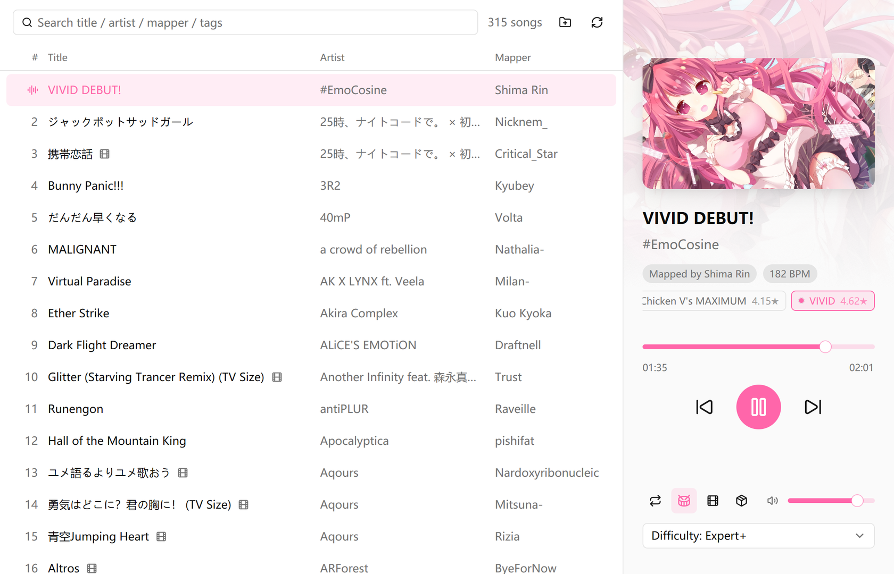
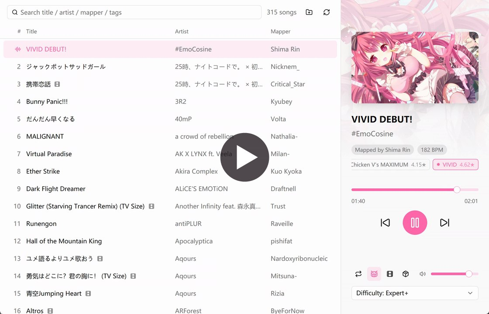
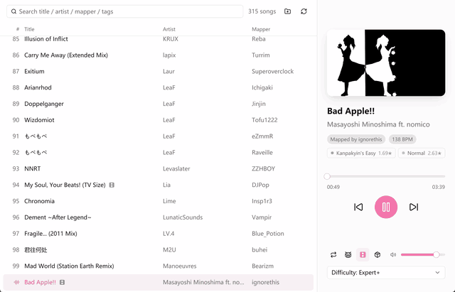

# osu! kiai

A music player for the songs you already have in osu!. It reads your osu!stable and osu!lazer libraries and plays them like any other music app. If you like, it can also play the hitsounds an Auto play would make, and show the beatmap's video behind the window.

<picture>
  <source media="(prefers-color-scheme: dark)" srcset="docs/screenshot-dark.png">
  
</picture>

## What it does

- Finds songs in osu!stable's Songs folder and in osu!lazer's library, plus any folders you add yourself.
- Searches title, artist, mapper, source and tags. Plays one song on repeat, the list in order, or shuffled.
- Follows the system's light or dark theme.

### Drum mode

With drum mode on, the beatmap's hitsounds play on top of the music, at the moments Auto would hit them: circles, slider heads, repeats, tails and ticks, and the end of spinners.

The tags under the title are the song's difficulties. Drum mode follows the selected one, and you can switch while the song is playing. For each new song, the **Difficulty** setting in the bottom corner decides which one is selected: the hardest difficulty in that category or below it, or the easiest one if they are all harder. The categories (Easy, Normal, Hard, Insane, Expert, Expert+) come from the star rating.

Beatmaps that ship their own hitsounds use them. The box button switches to osu!'s default ones instead.

[](docs/drum-mode.mp4)

*Drum mode demo (has sound). It's off for the first few seconds, then switched on.*

### Video mode

If a beatmap has a background video, video mode plays it dimmed behind the player. Leave the mouse alone for a few seconds and the interface fades out until only the video is left; move the mouse and it comes back.

Video mode needs [FFmpeg](https://ffmpeg.org/download.html): `winget install Gyan.FFmpeg` on Windows, `brew install ffmpeg` on macOS, or your distribution's package on Linux.



## Download

There are no releases yet. Every push builds Windows, Linux and macOS (Apple Silicon) binaries on GitHub Actions: open the latest run on the [Actions page](https://github.com/U2FsdGVkX1/osu-kiai/actions) and grab yours under Artifacts (you need to be signed in to GitHub to download).

- **Windows**: the `.exe` runs as it is.
- **Linux**: unpack the tarball and run `osu-kiai`. It needs ALSA and a Wayland or X11 session.
- **macOS**: unpack the tarball. The binary isn't signed, so if macOS refuses to open it, run `xattr -d com.apple.quarantine osu-kiai` once.

## Where it looks for songs

|         | osu!stable | osu!lazer |
| ------- | ---------- | --------- |
| Windows | `%LOCALAPPDATA%\osu!` | `%APPDATA%\osu` |
| Linux   | `~/.local/share/osu-wine/osu!` (osu-winello) | `~/.local/share/osu` |
| macOS   | | `~/Library/Application Support/osu` |

If you moved lazer's data elsewhere, the player follows `storage.ini` to find it. For anything else, use the folder button next to the search box. Added folders are kept in `osu-kiai.txt` in your config directory.

## Building

You need Rust 1.88 or newer.

```sh
cargo build --release
```

Release builds use LTO to keep the binary small, so they take a few minutes. On Windows you'll also need the Visual Studio C++ build tools. On Debian or Ubuntu, install these first:

```sh
sudo apt install libasound2-dev libfontconfig-dev libfreetype-dev libwayland-dev libxkbcommon-dev libxkbcommon-x11-dev
```

## Known limitations

- Settings aren't saved between launches yet.
- It's mostly developed and tested on Windows. The Linux and macOS builds compile in CI but haven't been used much, and hiding the mouse pointer in video mode doesn't work on Linux.

## License

The code is under the [GPL-3.0](LICENSE). The built-in hitsounds come from [ppy/osu-resources](https://github.com/ppy/osu-resources) and are licensed under CC BY-NC 4.0; see [assets/README.md](assets/README.md).

Built with [GPUI](https://gpui.rs) and [gpui-kit](https://github.com/longbridge/gpui-kit). Star ratings come from [rosu-pp](https://github.com/MaxOhn/rosu-pp), beatmap parsing from [rosu-map](https://github.com/MaxOhn/rosu-map), and audio playback from [rodio](https://github.com/RustAudio/rodio).

This project isn't affiliated with ppy. osu! is a trademark of ppy Pty Ltd.
